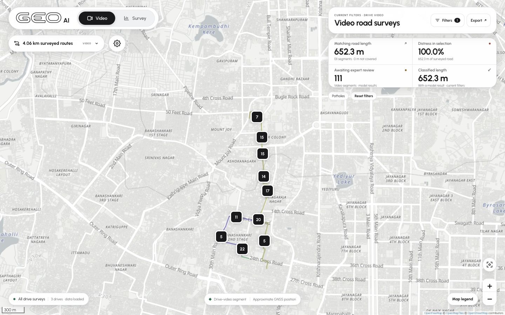

# GeoAI Video GIS

A separate, read-only dashboard for drive-video road surveys. The application lives in [`webgis/`](webgis/) and runs as static files at `/gis/app/`, using the existing `geoai.gis.v1` API. No frontend build, API key or database connection is needed.

The implemented scope follows the project owner's later instructions: **drive video only**, Potholes selected initially, and only **Video** and **Survey** in the primary navigation. Citizen/walking observations are excluded. This overrides the two-layer requirement in the original, unchanged [`GIS_VIDEO_HANDOFF.md`](GIS_VIDEO_HANDOFF.md).



## Run locally

Python 3.9+ is required for the supplied mock API. Obtain the sample first, then extract it beside `webgis/`:

```sh
git lfs install
git clone https://github.com/Suraj-B12/GeoAI_Video_GIS.git
cd GeoAI_Video_GIS
git lfs pull
python3 -m zipfile -e gis_sample.zip .
python3 gis_sample/mock_server.py --app webgis
```

Open **http://127.0.0.1:8765/gis/app/**. On Windows, use `python` instead of `python3` where needed. A plain static server cannot supply the API's filtering, summaries or images.

`gis_sample.zip` is tracked with Git LFS because it is about 139 MiB. If it is only about 130 bytes and begins with `version https://git-lfs.github.com/spec/v1`, it is a pointer; run `git lfs pull`. Without Git LFS, use GitHub's **Download** action on the ZIP to obtain the original file. See [Git LFS](https://git-lfs.com/) for installation. The extracted `gis_sample/` folder stays local and is ignored by Git.

## Included

- Drive routes, metadata-driven point/footprint markers, clusters, condition coverage, severity heatmap and historical BBMP ward overlay.
- Filter-aware metrics, date/label/severity/review/session/status filters, video CSV export and per-kilometre reports.
- Evidence with final expert/model labels, confidence, uncertainty and local time; virtualized frame strip and synchronized route replay.
- Full-screen map with floating controls, plus main GIS typography and motion: sliding navigation, anchored Survey and utility cards, light/dark presentation, phone layouts and reduced-motion support.
- Loading/error recovery, missing-image states and tests for future pending, skipped, uncovered and expert-corrected segments.

See [`webgis/README.md`](webgis/README.md) for controls, screenshots, interpretation, attribution and limitations. The sample's default Potholes view contains **131 segments**, **652.3 m** of matching road and **111** results awaiting expert review; all three drive tracks remain available.

## Verify

The test suite uses Node.js 20+ and Python 3.9+. It discovers Python automatically; set the `PYTHON` environment variable to a Python executable path if needed. Extract the original sample as above, then:

```sh
npm ci
npm test
python3 verification/sample-truth.py
```

With the mock running in another terminal:

```sh
python3 verification/api-integration.py http://127.0.0.1:8765
```

The delivered dashboard passed **69 automated tests**, **19 live HTTP checks**, and **58 sample checks**, including hashes for all **1,664** manifest-listed files. Desktop and phone interaction/design reviews are recorded in [`webgis/TEST-LOG.md`](webgis/TEST-LOG.md) and [`verification/`](verification/).

## Integrate with the VLM server

Copy only `webgis/` into the Capstone repository root, or set `GIS_APP_DIR` to it as described in the handoff. Keep `webgis/config.js` set to `apiBase: ""`. The existing FastAPI server serves the app at `/gis/app/` and provides `/gis/*`; this repository does not introduce a backend.

Production-host acceptance, production-volume performance and LAN image latency still need to be checked on the receiving VLM PC. Replay shows the pipeline's selected frames, because the contract has no original-video stream endpoint. The optional time slider and captured-map PDF are not included; filter URLs, a printable table report and dark presentation are included. The bundled 198-ward boundaries are historical, with source and licence in [`webgis/data/README.md`](webgis/data/README.md).
